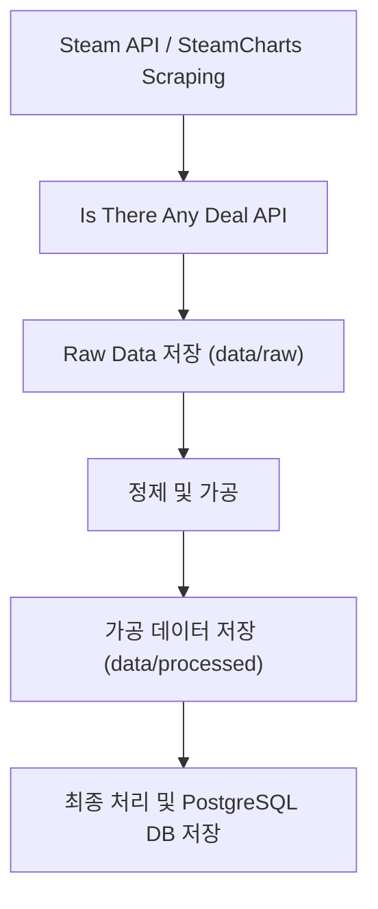

## Game Pricing Pipeline (WARA:B)


## 프로젝트 목적

본 프로젝트는 인기 게임들의 정보와 특가 정보를 제공하고, 간단하지만 편리한 팀 파인드 서비스를 제공하는 프로젝트인 [WARA:B](https://github.com/100-hours-a-week/9-team-gudokjohayo-warab-be)(백엔드 레포)의 일부로, 운영을 위한 게임 데이터 수집, 업데이트 등 서비스 제공에 필요한 데이터 관련 작업을 자동화하기 위해 개발된 파이프라인 모듈입니다.

해당 파이프라인은 운영에 없어서는 안 되지만 비교적 시간이 많이 소요되는 작업인 데이터 수집과 업데이트 작업을 배치 작업을 통해 자동화하고, 기초적인 캐싱 및 로그 기능을 통해 효율적이고 안정적인 업서트(Upsert) 작업을 수행하였습니다.

<details>
    <summary> 프로젝트 구조 </summary>

    game_data_pipeline/
    ├── README.md
    ├── config
    │   ├── settings.py
    │   └── settings.py.example
    ├── data
    │   ├── backup
    │   │   ├── category.csv
    │   │   ├── current_price_by_platform.csv
    │   │   ├── game_category.csv
    │   │   ├── game_dynamic.csv
    │   │   ├── game_static.csv
    │   │   └── platform.csv
    │   ├── cache
    │   │   ├── all_apps_cache.json
    │   │   ├── ap_status_cache.json
    │   │   ├── detail_status_cache.json
    │   │   ├── itad_id_status_cache.json
    │   │   ├── itad_price_status_cache.json
    │   │   ├── review_status_cache.json
    │   │   └── steamcharts_status_cache.json
    │   ├── error
    │   │   ├── failed_detail_ids.csv
    │   │   └── itad_price_failed_ids.csv
    │   ├── processed
    │   └── raw
    │       ├── all_app_list.csv
    │       ├── common_ids.csv
    │       ├── free_steam_list.csv
    │       ├── itad_game_ids.csv
    │       ├── itad_game_prices.csv
    │       ├── paid_steam_list.csv
    │       ├── steam_game_active_player.csv
    │       ├── steam_game_detail_original.csv
    │       ├── steam_game_detail_parsed.csv
    │       ├── steam_game_reviews.csv
    │       └── steamcharts_top_games.csv
    ├── db
    │   ├── ddl.sql
    │   ├── ddl_full.sql
    │   └── ddl_initialize.sql
    ├── log
    │   ├── db_uploader
    │   │   └── DBUploader.log
    │   ├── fetcher
    │   │   ├── itad_id_fetcher.log
    │   │   ├── itad_price_fetcher.log
    │   │   ├── steam_active_player_fetcher.log
    │   │   ├── steam_detail_fetcher.log
    │   │   ├── steam_list_fetcher.log
    │   │   └── steam_review_fetcher.log
    │   ├── main
    │   │   └── main_pipeline.log
    │   └── process_data
    │       └── process_data.log
    ├── main.py
    ├── pipeline
    │   ├── __init__.py
    │   ├── backup_tables.py
    │   ├── base_fetcher.py
    │   ├── fetch_itad_id.py
    │   ├── fetch_itad_price.py
    │   ├── fetch_steam_active_player.py
    │   ├── fetch_steam_detail.py
    │   ├── fetch_steam_list.py
    │   ├── fetch_steam_review.py
    │   ├── filter_list.py
    │   ├── process_data.py
    │   └── save_to_db.py
    ├── pytest.ini
    ├── requirements.txt
    ├── test
    │   ├── test_itad_id_fetcher.py
    │   ├── test_itad_price_fetcher.py
    │   ├── test_steam_active_player_fetcher.py
    │   ├── test_steam_detail_fetcher.py
    │   ├── test_steam_list_fetcher.py
    │   └── test_steam_review_fetcher.py
    ├── test_data
    │   ├── backup
    │   ├── cache
    │   │   ├── ap_status_cache.json
    │   │   ├── detail_status_cache.json
    │   │   ├── review_status_cache.json
    │   │   └── steamcharts_status_cache.json
    │   ├── error
    │   │   ├── failed_ap_ids.csv
    │   │   └── failed_detail_ids.csv
    │   ├── log
    │   │   └── itad_data_fetcher.log
    │   ├── processed
    │   └── raw
    │       ├── all_app_list.csv
    │       ├── common_ids.csv
    │       ├── steam_app_ids.csv
    │       ├── steam_game_active_player.csv
    │       ├── steam_game_detail_original.csv
    │       ├── steam_game_detail_parsed.csv
    │       ├── steam_game_reviews.csv
    │       └── steamcharts_top_games.csv
    └── util
        ├── cache_manager.py
        ├── data_insert.py
        ├── db_schema_helper.py
        ├── io_helper.py
        ├── logger.py
        └── rate_limit_manager.py

  ## 주요 디렉터리 설명

  - `config/`
  
    파이프라인 환경 설정 파일을 관리 (settings.py, 예시 파일 제공)

  - `data/`
  
    수집된 원본 데이터 (`raw`), 가공된 데이터 (`processed`), 오류 데이터 (`error`), 캐시 파일 데이터 (`cache`), 백업 파일 데이터 (`backup`)를 저장

  - `db/`
  
    데이터베이스 테이블 생성을 위한 DDL 스크립트 관리

  - `log/`
  
    수집. 가공, 업로드 과정별 로그 파일을 기록

  - `pipeline/`

    데이터 수집, 처리, 저장을 담당하는 주요 파이프라인 코드 포함

  - `test/`

    각 fetcher 모듈에 대한 유닛 테스트 코드 (진행 중)

  - `test_data/`

    테스트 데이터 셋 저장

  - `util/`

    공통적으로 사용되는 헬퍼 모듈들을 모아놓은 디렉터리 (캐시 관리, DB 스키마, 로깅 등)

  - `main.py`

    전체 파이프라인을 실행하는 진입점 파일

</details>

## 시스템 아키텍처

본 데이터 파이프라인은 AWS EC2 환경에서 실행되어, Steam 및 ITAD와 같은 외부 API로부터 데이터를 수집합니다. 수집된 원본 데이터와 로그, 백업 파일 등은 EC2 로컬 및 S3에 저장되어, 최종적으로 정제된 데이터는 서비스가 사용하는 PostgreSQL 데이터베이스에 적재됩니다.


## 데이터 흐름



## 주요 기능 및 모듈 설명

- Steam 앱 리스트 수집 및 필터링
- Steam 게임 상세 정보 및 리뷰 수집
- 활성 플레이어 수 데이터 수집

- Is There Any Deal API를 통한 가격 정보 수집
- 데이터 정제 및 PostgreSQL 데이터베이스 저장
- 실패한 ID 재시도 및 캐시 관리 기능
- 로그 기록 및 백업 기능
- 내부 데이터 S3 동기화

## 사용한 기술 스택

  

## 빠른 시작

```bash
# 패키지 설치
pip install -r requirements.txt

# 환경 설정 (자세한건 아래 참조)
cp config/settings.py.example config/settings.py
# settings.py DB 정보에 맞춰 수정

# 파이프라인 실행
python main.py
```

### 파이프라인 모듈
- `fetch_steam_list.py` : Steam 앱 리스트 수집
- `fetch_steam_detail.py` : 게임 상세 정보 수집
- `fetch_steam_review.py` : 게임 리뷰 데이터 수집
- `fetch_steam_active_player.py` : 활성 플레이어 수 데이터 수집
- `fetch_itad_id.py` : ITAD에 등록된 게임 ID 수집
- `fetch_itad_price.py` : ITAD를 통한 가격 데이터 수집
- `process_data.py` : 수집된 데이터 가공 및 정리
- `save_to_db.py` : 최종 데이터베이스 저장

### 환경변수 설명

`steam_api_key`: Steam API 요청용 키

`webapi_token`: Steam Web API 사용 토큰

`itad_key`: ITAD API 요청용 키

`s3_bucket`	(선택): S3에 파일 업로드 시 사용할 버킷 이름

`aws_region`: AWS 리전 정보 (예: ap-northeast-2)

`aws_access_key_id`: AWS Access Key

`aws_secret_access_key`: AWS Secret Access Key

`local_db_host`: 로컬 환경 DB 서버 주소

`dev_db_host`: 개발 환경 DB 서버 주소

`prod_db_host`: 운영 환경 DB 서버 주소

`list_dir`: 전체 게임 리스트 파일 경로

`paid_list_dir`: 유료 게임 리스트 파일 경로

`free_list_dir`: 무료 게임 리스트 파일 경로

`env`: 기본 환경 설정 (local, dev, prod)

## 향후 개선 과제

본 파이프라인은 현재 기능적으로 목표를 달성했지만, 더 높은 수준의 성능과 유지보수성을 위해 다음과 같은 리팩토링을 계획하고 있습니다.

1. 코드의 유지 보수성과 가독성 향상
    - SOLID 원칙을 적용한 코드 품질 향상
    - 거대한 단일 클래스 모듈을 책임별로 분해
    - 확장 가능한 설계로 변경
2. 병목 구간 분석 및 효율성 향상
   - 순차적 파이프라인 형태에서의 병목 지점 파악
   - 비동기 처리 및 API 제약 사항에 대한 실험
3. 테스트 커버리지 확대
   - 각 메소드와 모듈에 대한 테스트 커버리지를 최대화
